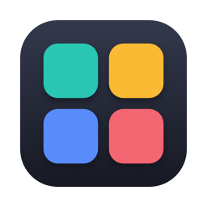

<p align="center"></p>

<h1 align="center">Epp</h1>

<p align="center">Mac을 편하게 쓰는 작은 기능 모음 (Eddie's app)<br>메뉴바 아이콘 하나에서 필요한 기능만 켜서 써요.</p>

<p align="center"><a href="#english">English</a></p>

## 들어 있는 기능

| 기능 | 하는 일 |
|---|---|
| **클립보드** | 복사한 내용을 모아 두고 다시 붙여 넣는 클립보드 기록 (⌃⌥V) |
| **메뉴바** | 노치에 가려진 메뉴바 아이콘 꺼내 보기, 고른 아이콘 메뉴바에서 숨기기 |
| **스티커** | 다른 창 위에 띄워 두는 스티커 메모 (⌃⌘N) |
| **타이머** | 넘김시계 타이머·알람·스톱워치와 일정 알림 (⌃⌥C) |
| **캡처** | 찍고, 그리고, 바로 붙여 넣는 화면 캡처 (⇧⌘1~6) |

따로 있던 메뉴바 앱 다섯 개(Keepy, Peeky, Floaty, Clocky, Grabby)를 하나로 모았어요.

## 설치

1. [Releases](https://github.com/eddieee-git/mac-app-epp/releases/latest)에서 **Epp-<버전>.dmg**를 내려받아 Epp를 응용 프로그램 폴더로 끌어다 놓아요.
2. 처음 열 때 경고가 나오면 **완료**를 누른 뒤 시스템 설정 → 개인정보 보호 및 보안 맨 아래의 **그래도 열기**를 눌러요(macOS 14는 오른쪽 클릭 → 열기).
3. 설정 창이 열리면 쓸 기능을 켜요. 처음에는 모두 꺼져 있어요. 기능마다 **시작하기**가 할 일을 안내해요.
4. 필요한 권한은 **설정 → 일반 → 권한**에서 한 번에 허용해요.

## 쓰는 방법

- **메뉴**: 메뉴바의 Epp 아이콘(네모 네 개)을 누르면 켠 기능이 하나씩 하위 메뉴로 나와요. Dock에는 보이지 않아요(설정에서 켤 수 있어요).
- **설정 한곳**: 왼쪽에 일반과 기능 목록, 위에 **설정 검색**이 있어요. 기능 설정은 모두 같은 모양이에요(시작하기 → 일반 · 기능 고유 · 단축키).
- **빠른 검색 (⌃⌥E)**: 켠 기능의 내용을 한 번에 찾아요. 클립보드 기록(고르면 앞의 앱에 붙여 넣기), 스티커(잠근 것은 빼고), 캡처 속 글자·메모, 타이머·알람(메모까지).
  바로 실행도 돼요: `5분`·`1시간 30분`(그 시간 타이머 시작), `새 스티커 장보기`(그 글로 스티커), `캡처`, `클립보드`, `메뉴바`, `설정`.
- **기능 잇기**: 클립보드 기록 창에서 글을 오른쪽 클릭 → **스티커로 만들기**. 캡처의 "글자 복사"로 복사한 글도 이렇게 스티커로 만들 수 있어요.
- **알람 한곳**: 타이머를 켜 두면 스티커 알람도 타이머 알람과 똑같이 울려요(같은 소리, ⌃⌥X로 끄기, 다시 울림). 스티커는 앞으로 나와 깜빡이고, 어느 쪽에서 꺼도 둘 다 꺼져요.
- **메뉴바 정리**: 아이콘마다 「보이기」(그대로) / 「그룹」(메뉴바에서 빼고 그룹 아이콘 <>을 누르면 열리는 바에 모음, 어느 그룹인지까지 한 번에) / 「숨기기」(메뉴바에서 빼기만, ‹ ›로 잠깐 보기) 중 하나를 골라요. ‹ › 버튼은 처음에 메뉴바 아이콘들의 맨 왼쪽에 생겨요.
- **알람 메모**: 타이머 목록(⌘L)에서 알람에 메모를 남기면 시계 창과 울릴 때 함께 보여요.
- **메뉴바 아이콘을 늘리지 않아요**: 타이머 남은 시간은 Epp 아이콘 바로 옆에 붙어요(타이머 설정에서 따로 보이게 할 수 있어요). 메뉴바 기능의 그룹 아이콘은 그 기능이 하는 일이라 따로 생겨요.
- **단축키**: 기능마다 단축키 탭에서 바꿔요. 다른 기능과 겹치면 그 탭 위에 알려 줘요.
- **주소로 열기**(단축어 등): `epp://keepy/show`, `epp://peeky/open`, `epp://peeky/arrange`, `epp://floaty/new`, `epp://floaty/manager`, `epp://floaty/toggle`, `epp://clocky/show`, `epp://clocky/list`, `epp://clocky/toggle`, `epp://grabby/area`, `epp://grabby/library`.
  웹페이지도 이 주소를 열 수 있어서, 직접 고르지 않아도 되는 화면 전체 캡처는 주소로 열지 않아요. 10초에 5번이 넘게 오면 무시해요.

## 설정 (일반)

| 항목 | 설명 |
|---|---|
| 기능 | 기능마다 켜기/끄기 (기본 모두 끔). 끈 기능은 아무 일도 하지 않아요 |
| 권한 | 켠 기능이 쓰는 권한(손쉬운 사용, 화면 기록, 알림, 캘린더)과 이유를 한곳에서 |
| 빠른 검색 | 단축키 (기본 ⌃⌥E) |
| 로그인 시 실행 · Dock에 아이콘 보이기 | 기본 끔 |
| 테마 | 라이트 / 다크 / 시스템. Epp의 모든 창에 똑같이 |
| 언어 | 시스템(Mac 언어 목록에 한국어가 있으면 한국어) / 한국어 / English. 바꾸면 Epp를 다시 열어요 |
| 문제 해결 | 진단 로그(개인 내용은 적지 않아요), 데이터 폴더 |
| 설정 옮기기 | 「설정만」 또는 「모두」(내용과 암호화 열쇠까지, 정한 암호로 잠근 파일 하나) 내보내기·가져오기. 새 Mac으로 옮길 때 |
| 업데이트 | 하루 한 번 확인, Epp를 쓰지 않을 때 자동 설치 (기본 켬) |

## 개인 정보와 보안

- 모든 데이터는 이 Mac에만 저장해요: `~/Library/Application Support/Epp/<기능>/`. 어디로도 보내지 않아요.
- **클립보드 기록, 잠근 스티커, 캡처 보관함은 암호화**해서 저장해요(열쇠는 키체인, Epp만 읽어요). 캡처를 다른 앱으로 끌어다 놓을 때만 임시 사본을 풀어 두고 다음에 켤 때 지워요.
- 비밀번호 관리 앱(1Password, Bitwarden 등)에서 복사한 것과 비밀번호 칸의 내용은 기록하지 않아요.
- 「모두 내보내기」 파일은 정한 암호로 잠가요(PBKDF2 + AES-GCM). 암호를 잊으면 열 수 없어요.
- 고정하지 않은 클립보드 기록은 기본 30일, 캡처는 정한 개수·기간이 지나면 지워요.
- 업데이트는 GitHub에 최신 버전 번호만 물어보고, 내려받은 파일의 서명(Ed25519)·SHA-256·코드 서명을 모두 확인한 뒤에 바꿔 넣어요.

## 알려진 제한

- Apple 실리콘 Mac, macOS 14 이상.
- Apple 개발자 서명이 없어서 처음 열 때 경고가 나와요.
- 옛 단독 앱(Keepy 등)의 데이터는 가져오지 않아요. 같은 기능의 옛 앱과 함께 켜면 단축키가 겹쳐요.

## 직접 빌드하기

Xcode 없이 Command Line Tools만 있으면 돼요.

```bash
./scripts/test.sh          # 자동 점검
./scripts/run.sh           # 시험용 Epp Dev 빌드 후 켜기(실제 Epp와 설정·데이터가 섞이지 않아요)
./scripts/build-app.sh     # build/Epp.app + build/Epp-<버전>.dmg
```

## English

Epp (Eddie's app) gathers five small Mac menu bar tools under one icon: **Clipboard** history, **Menu Bar** icons behind the notch, **Stickies**, a flip-clock **Timer** with alarms and calendar alerts, and screen **Capture** with markup. Turn on only the features you want in Settings → General; features that are off do nothing.

- One menu bar icon, one Settings window (with search), one place for permissions, one appearance setting.
- **Quick Search (⌃⌥E)** finds clipboard history, stickies (except locked ones), text in captures, and timers.
- Sticky alarms ring through the Timer when it's on, with the same sound, ⌃⌥X to stop, and snooze.
- Clipboard history and locked stickies are encrypted on disk; nothing leaves your Mac. Updates are verified (Ed25519 signature, SHA-256, code signature) before installing.
- Apple silicon, macOS 14 or later. Not signed by Apple, so macOS warns on first launch: click **Done**, then **Open Anyway** in System Settings → Privacy & Security.
